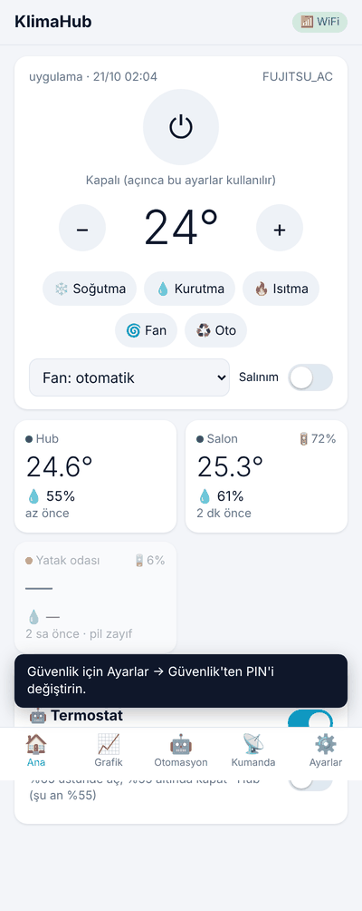
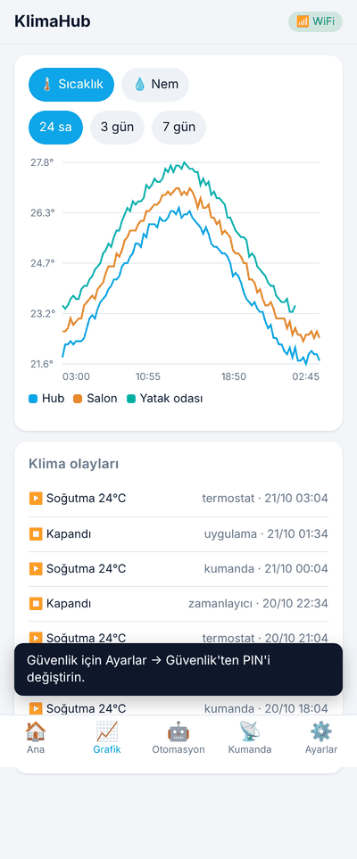
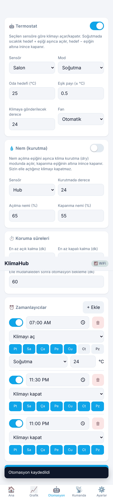
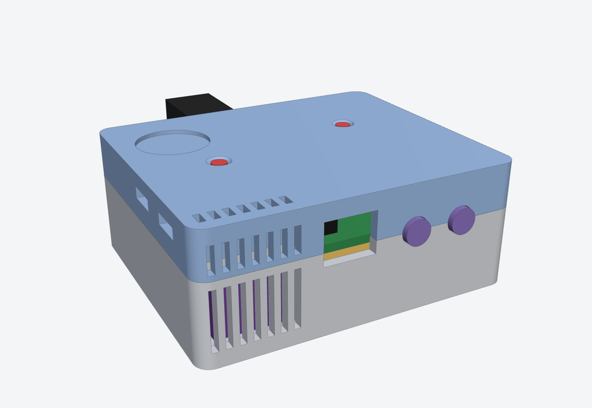
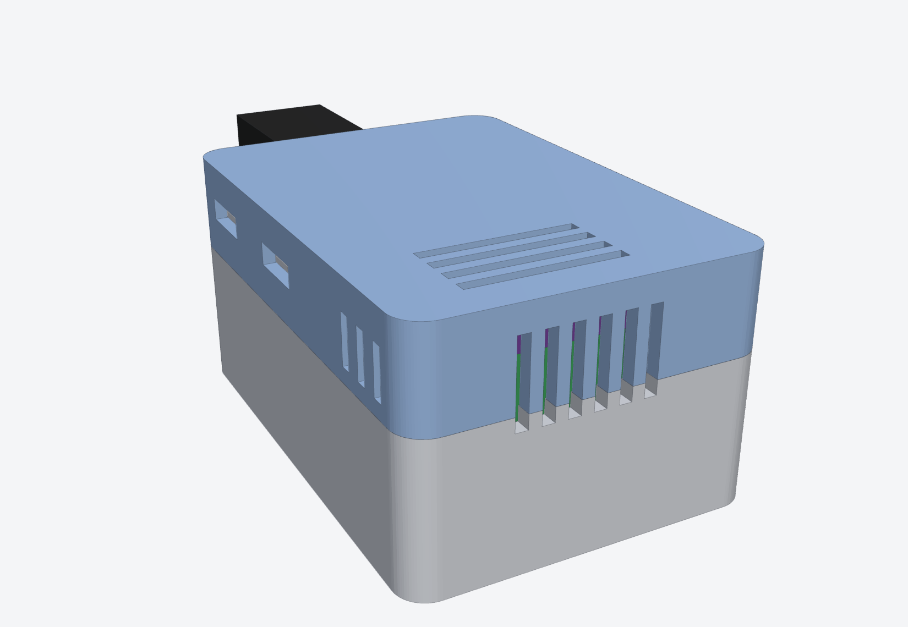
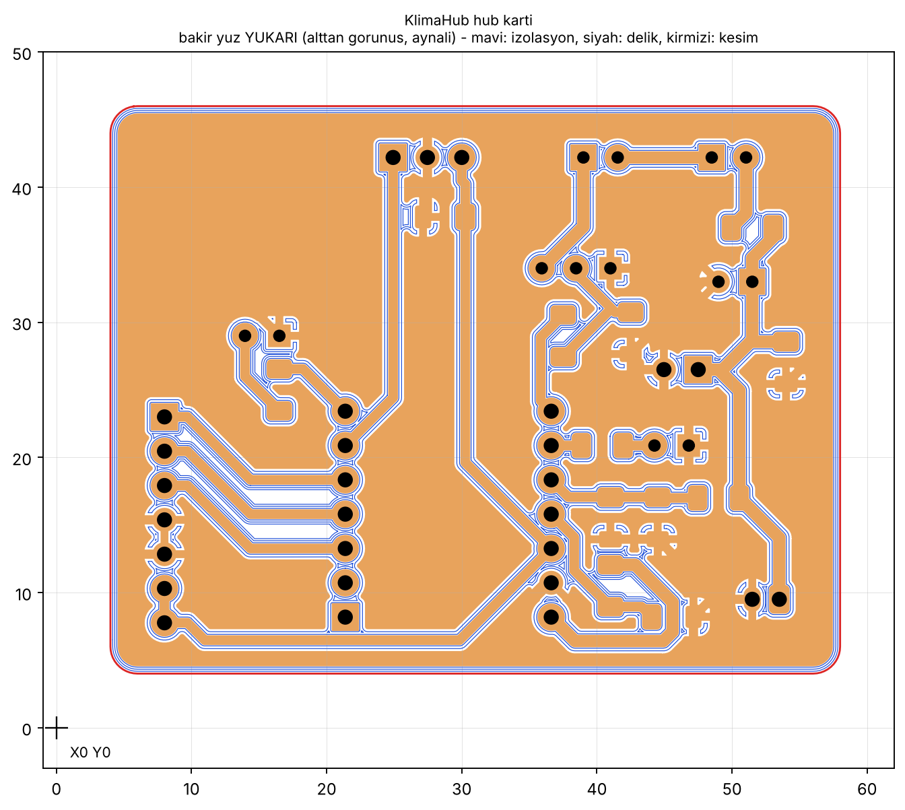
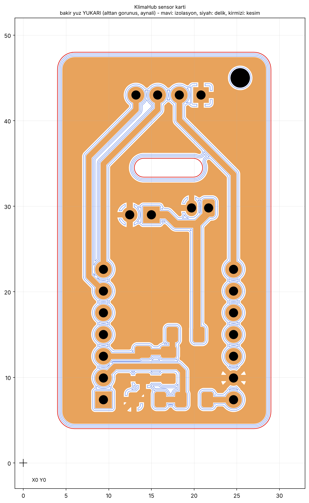

# KlimaHub: IoT Klima Kumandası ve Sıcaklık/Nem Sensörleri

ESP32 tabanlı, evdeki WiFi kopmalarına dayanıklı bir klima kontrol sistemi. Kendi kartınızı
CNC'de kazıyıp, kutusunu 3D yazıcıda basıp kurabileceğiniz şekilde, baştan sona hazır.

| Parça | Kart | Görev |
|---|---|---|
| **Hub** | Seeed XIAO ESP32-S3 | Klimaya IR ile komut verir, kumandayı öğrenir. Kendi SHT31 sensörü, kırmızı/yeşil LED, dokunmatik buton ve LiPo pili var |
| **Sensör × 2** | Seeed XIAO ESP32-C3 | Duvarda sıcaklık/nem ölçer, ESP-NOW ile hub'a gönderir. Pille 6–9 ay, USB-C ile şarj |

<p>



</p>

## Özellikler

- **WiFi kopsa da çalışır:** Sensörler ESP-NOW ile modemden bağımsız haberleşir. Klima kontrolü,
  otomasyon ve Bluetooth bağlantısı WiFi olmadan devam eder. Hub WiFi'a hiç vazgeçmeden yeniden
  bağlanmayı dener.
- **Klima kontrolü:** Aç/kapa, mod (soğutma, ısıtma, kuru, fan, otomatik), derece, fan, kanat.
  Fujitsu dahil ≈80 klima protokolü kumandadan otomatik tanınır. Tanınmayan kumandalar ham
  kayıtla öğretilir.
- **Otomasyon:** Termostat (seçilen sensöre göre), nem için kurutma modu, haftalık
  zamanlayıcılar, kısa döngü koruması.
- **7 günlük geçmiş:** Her sensör için sıcaklık ve nem grafikleri.
- **Telefon uygulaması:** Türkçe web uygulaması. Bluetooth (her yerde) veya WiFi
  (`http://klima.local`) ile bağlanır, ana ekrana kurulabilir.
- **Telegram botu:** Dışarıdan kontrol (`/durum`, `/ac 24 sogutma`…) ve bildirimler (pil, sensör,
  elektrik kesintisi, WiFi kesintisi, otomasyon).
- **Ölçüm aralığı** her sensör için uygulamadan ayarlanır (varsayılan 10 dk).

## Nereden başlamalı

1. [docs/RAPOR.md](docs/RAPOR.md): projenin durumu ve yapılacaklar listesi
2. [docs/SATIN_ALMA.md](docs/SATIN_ALMA.md): hazır sepet (3 site, bağlantılı) ·
   [docs/MALZEME_LISTESI.md](docs/MALZEME_LISTESI.md): parçaların teknik tanımı
3. Kartlar: [pcb/fab/README.md](pcb/fab/README.md) ile fabrikaya sipariş **veya**
   [docs/CNC.md](docs/CNC.md) ile CNC'de kazıma (Candle)
4. [enclosure/README.md](enclosure/README.md): kutuların baskısı
5. [docs/MONTAJ.md](docs/MONTAJ.md): lehim ve montaj
6. [docs/KURULUM.md](docs/KURULUM.md): yazılım yükleme, WiFi, kumanda, sensörler, Telegram

Ayrıntılı tasarım: [docs/MIMARI.md](docs/MIMARI.md) · Komut arayüzü: [docs/API.md](docs/API.md)

## Klasörler

```
app/                 Web uygulaması (tek dosya PWA) + sahte hub ve test araçları
firmware/hub/        Hub yazılımı (PlatformIO, Arduino)
firmware/sensor/     Sensör yazılımı
firmware/lib/        Ortak kod: ESP-NOW protokolü, pil hesabı, SHT31 sürücüsü
firmware/bin/        Hazır yazılım dosyaları (tarayıcıdan yüklemek için)
pcb/                 KiCad kartları, üretici betikler, Gerber ve CNC (G-code) çıktıları
enclosure/           3D kutular (STL, STEP) ve CadQuery kaynak kodu
docs/                Belgeler
```

## Görseller

<p>


</p>
<p>


</p>

## Geliştirme

```bash
# Yazılım (PlatformIO)
pio run -d firmware/hub            # hub derle
pio test -d firmware/hub -e native # birim testleri
pio run -d firmware/sensor         # sensör derle

# Uygulamayı donanımsız deneme
pip install aiohttp && python3 app/tools/mock_hub.py   # http://localhost:8080, PIN 1234

# Kartlar (KiCad 7+ ve Freerouting gerekir), G-code ve montaj haritaları
python3 pcb/tools/build_pcb.py all
python3 pcb/tools/cnc.py all --angle 30 --tip 0.2
python3 pcb/tools/assembly_maps.py all
python3 pcb/tools/build_fab.py all      # fabrika (2 katman) sürümü

# Kutular (CadQuery)
python3 enclosure/build_enclosures.py
```

Her push'ta GitHub Actions iki yazılımı derler, birim testlerini ve uygulamanın tarayıcı testini
çalıştırır. `app/` değişince uygulama GitHub Pages'te yayınlanır.

**Gizli bilgiler** (WiFi şifresi, Telegram token'ı) depoya hiçbir zaman yazılmaz. Uygulamadan
cihaza girilir ve yalnızca hub'ın içinde saklanır.
