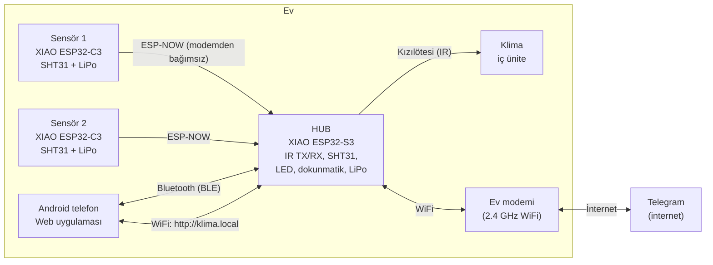

# Sistem Mimarisi

Bu belge sistemin **neden böyle tasarlandığını** ve tüm parçaların (devre, yazılım,
haberleşme) birbirine nasıl bağlandığını anlatır. Montaj için `MONTAJ.md`, ilk kurulum
için `KURULUM.md` belgesine bakın.

## 1. Genel bakış



**Temel ilke:** Hub, evin WiFi'ı **olmadan da** tam çalışır.

| Özellik | WiFi varken | WiFi koptuğunda |
|---|---|---|
| Sensör verisi (ESP-NOW) | ✅ | ✅ (modem gerekmez) |
| Klima kontrolü (IR) | ✅ | ✅ |
| Termostat / nem otomasyonu | ✅ | ✅ |
| Zamanlayıcılar | ✅ | ✅ (saat iç saatten devam eder) |
| Telefon – Bluetooth | ✅ | ✅ |
| Telefon – `http://klima.local` | ✅ | ❌ |
| Telegram (dışarıdan erişim + bildirim) | ✅ | ⏳ bildirimler sıraya alınır, bağlantı gelince gönderilir |

## 2. Kartlar

| Cihaz | Kart | Neden |
|---|---|---|
| Hub | **Seeed XIAO ESP32-S3** | Çift çekirdek, 8 MB flash + 8 MB PSRAM; WiFi + BLE + ESP-NOW + web sunucu + Telegram aynı anda rahat çalışır. Dahili LiPo şarj devresi (≈100 mA). |
| Sensör | **Seeed XIAO ESP32-C3** | Ucuz, derin uykuda ≈44 µA. Dahili LiPo şarj devresi (≈350–380 mA → **en az 400 mAh pil**; 503035/500 mAh uygundur). |

Her iki kartta da yerleşik anten yoktur; **U.FL (IPEX) konnektörüne harici anten** takılır.
Çoğu satıcı kutudan antenle gönderir, ürün sayfasında "anten dahil" yazdığını kontrol edin.

XIAO ayak dizilimi (üstten bakış, USB-C yukarıda):

```
            USB-C
        ┌───────────┐
   D0  ─┤ 1      14 ├─ 5V   (USB'den gelen 5 V)
   D1  ─┤ 2      13 ├─ GND
   D2  ─┤ 3      12 ├─ 3V3  (kart regülatör çıkışı)
   D3  ─┤ 4      11 ├─ D10
   D4  ─┤ 5      10 ├─ D9
   D5  ─┤ 6       9 ├─ D8
   D6  ─┤ 7       8 ├─ D7
        └───────────┘
   (Alt yüzde BAT+ / BAT- pedleri: pil buraya bağlanır)
```

Sıra aralığı 15.24 mm (0.6"), pin aralığı 2.54 mm.

## 3. Hub devresi

### 3.1 Pin eşlemesi (XIAO ESP32-S3)

| XIAO pini | GPIO | Görev | Not |
|---|---|---|---|
| D0 | GPIO1 | Pil voltajı (ADC) | 220k/220k bölücü + 100 nF |
| D1 | GPIO2 | USB (adaptör) var mı? (ADC) | 100k/150k bölücü. Derin uykudan uyandırma pini |
| D2 | GPIO3 | Dokunmatik buton (TTP223 çıkışı) | Aktif HIGH |
| D3 | GPIO4 | IR alıcı (VS1838B çıkışı) | |
| D4 | GPIO5 | I²C SDA → SHT31 | |
| D5 | GPIO6 | I²C SCL → SHT31 | |
| D6 | GPIO43 | (boş) | Açılışta UART log'u verdiği için LED'e bağlanmadı |
| D7 | GPIO44 | (boş) | |
| D8 | GPIO7 | IR LED sürücü transistörü (S8050) | 150 Ω baz + 10k pull-down |
| D9 | GPIO8 | Yeşil LED | 470 Ω |
| D10 | GPIO9 | Kırmızı LED | 470 Ω |

### 3.2 Devre şeması (metin)

```
 PİL (503035, 3.7 V) ──JST-PH──┬───────────────► XIAO BAT+ (alt ped, kablo ile)
                               │   GND ────────► XIAO BAT-
                               │
                               ├─ R1 220k ─┬─ R2 220k ─ GND
                               │           └──► D0 (GPIO1)  + C1 100nF→GND
                               │
                               └─ D2 SS14 ─┐
 XIAO 5V ──────────────────────── D1 SS14 ─┴──► VIR (IR besleme, ~3.4–4.7 V)
   │                                              ├─ C2 220µF + C3 100nF → GND
   └─ R3 100k ─┬─ R4 150k ─ GND                    │
               └──► D1 (GPIO2) + C4 100nF          ├─ R5 27Ω ─ IR LED1 ─┐
                                                   └─ R6 27Ω ─ IR LED2 ─┤
                                                                       C (Q1 S8050)
 D8 (GPIO7) ─ R7 150Ω ─► B (Q1)      B ─ R8 10k ─ GND                   E ─ GND

 3V3 ─┬─ VS1838B VCC     VS1838B OUT ──► D3 (GPIO4)      C5 100nF (VCC-GND)
      ├─ SHT31 VIN       SHT31 SDA/SCL ──► D4/D5
      └─ TTP223 VCC      TTP223 OUT ──► D2 (GPIO3)

 D9 (GPIO8)  ─ R9 470Ω  ─ Yeşil LED ─ GND
 D10 (GPIO9) ─ R10 470Ω ─ Kırmızı LED ─ GND
```

**Tasarım kararları:**

- **IR LED beslemesi iki kaynaktan (diyot-VEYA):** Adaptör takılıyken 5 V'tan, çıkarılınca
  doğrudan pilden beslenir. Böylece pille çalışırken de klima kontrol edilebilir. 3V3
  regülatörü yorulmaz, WiFi yayın tepeleriyle birleşip kartı resetlemez.
- **2 IR LED paralel, her biri kendi direnciyle:** Adaptörde ≈115 mA, pilde ≈70 mA darbe
  akımı. 3–4 m karşıdaki klima için fazlasıyla yeterli. Biri düz, diğeri ≈20° yukarı
  bakacak şekilde bükülür (klima genelde yüksekte durur).
- **220 µF kondansatör:** 38 kHz IR darbelerinin akım tepelerini karşılar.
- **10k pull-down:** Açılışta GPIO boşta kalırken IR LED'lerin yanmasını engeller.
- **Pil bölücü 220k+220k:** Pilden sürekli ≈8 µA çeker, hub için önemsiz.
- **USB algılama:** Adaptör çekilince hub pil tasarrufu moduna geçer. Pil kritik seviyeye
  düşerse derin uykuya girer, adaptör takılınca bu pin sayesinde kendiliğinden uyanır.

### 3.3 Konnektörler

| Etiket | Pin sırası | Bağlanan |
|---|---|---|
| J1 BAT | `+`, `-` (JST-PH 2.0 mm) | 503035 LiPo. **Pil kablosu kutupları satıcıya göre ters olabilir, takmadan önce ölçün!** |
| J2 XBAT | `+`, `-` | XIAO alt yüzündeki BAT+/BAT- pedlerine kısa kablo |
| J3 SHT31 | `3V3`, `GND`, `SCL`, `SDA` | Sıcaklık/nem modülü (kutunun havalandırmalı bölmesinde) |
| J4 TOUCH | `3V3`, `OUT`, `GND` | TTP223 dokunmatik modülü (kutu üst kapağının altında) |

## 4. Sensör devresi

### 4.1 Pin eşlemesi (XIAO ESP32-C3)

| XIAO pini | GPIO | Görev | Not |
|---|---|---|---|
| D1 | GPIO3 | Pil voltajı (ADC1) | 470k/470k bölücü + 100 nF (≈4 µA) |
| D2 | GPIO4 | SHT31 besleme | Sensör sadece ölçüm anında beslenir → uykuda 0 akım |
| D3 | GPIO5 | USB var mı? (dijital) | 100k/150k bölücü. "Şarj oluyor" bilgisi |
| D4 | GPIO6 | I²C SDA | |
| D5 | GPIO7 | I²C SCL | |
| D0 | GPIO2 | (boş) | Açılış (strapping) pini, bilerek kullanılmadı |

### 4.2 Devre şeması (metin)

```
 PİL ──JST-PH──┬──────────────► XIAO BAT+ (kablo)
               ├─ R1 470k ─┬─ R2 470k ─ GND
               │           └──► D1 (GPIO3) + C1 100nF
 XIAO 5V ─ R3 100k ─┬─ R4 150k ─ GND
                    └──► D3 (GPIO5)
 D2 (GPIO4) ──► SHT31 VIN      SHT31 SDA/SCL ──► D4/D5
```

### 4.3 Çalışma döngüsü ve pil ömrü

1. RTC zamanlayıcısıyla uyanır (varsayılan **10 dk**, uygulamadan 1–60 dk ayarlanır).
2. SHT31'i besler, ölçer (≈20 ms), beslemeyi keser.
3. Pil voltajını ve USB durumunu okur.
4. ESP-NOW ile hub'a gönderir, hub'ın onayını (ACK) bekler (en fazla ≈80 ms).
5. Onayla birlikte hub'dan yeni ayarları (ölçüm aralığı, saat) alır.
6. Derin uykuya döner.

Uyanık kalma süresi ≈0.2–0.3 sn. 10 dk aralıkla günlük tüketim ≈1.4 mAh, yani 500 mAh pil
**teorik olarak 10+ ay** dayanır. Pratikte pilin kendi kendine boşalması ve sıcaklık
etkileri yüzünden 6–9 ay beklenmelidir.

**Hub'a ulaşılamazsa:** Ölçümler RTC belleğinde biriktirilir (64 ölçüm = 10 dk aralıkla
≈10 saat). Hub'a tekrar ulaşınca toplu gönderilir, grafikte boşluk kalmaz.

## 5. Haberleşme

### 5.1 ESP-NOW (sensör ↔ hub)

- **Neden ESP-NOW:** Modemden bağımsızdır ve sensör WiFi'a "bağlanmak" için 2–3 sn
  harcamaz, paket ≈1 ms'de gider. Pil ömrü WiFi'a göre ≈10 kat uzar.
- **Kanal sorunu:** ESP-NOW'da iki tarafın aynı WiFi kanalında olması gerekir. Hub,
  modeme bağlıyken modemin kanalındadır. Modem kanal değiştirirse:
  1. Sensör onay alamaz, bir kez tekrar dener.
  2. Yine alamazsa 1–13 arası kanalları tarar (her kanalda ≈40 ms).
  3. Hub'ı bulduğu kanalı RTC belleğe yazar, sonraki uyanmalarda doğrudan kullanır.
  4. Tarama pil harcamasın diye ardışık başarısızlıklarda taramayı seyreltir.
- **Eşleşme:** Gerekmez. Sensör ilk açılışta yayın (broadcast) adresine gönderir. Hub
  yanıtladığında hub'ın MAC adresini öğrenir ve sonrasında doğrudan ona gönderir.
  Hub en fazla 4 sensörü otomatik kaydeder. Uygulamadan isim verilir veya silinir.
- **Paketler** (`firmware/lib/klima_common/klima_protocol.h`):
  - `REPORT` (sensör → hub): pil mV/%, bayraklar (USB, sensör hatası, ilk açılış),
    mevcut aralık, açılış sayacı, firmware sürümü ve 1–25 ölçüm
    (`yaş_sn`, `sıcaklık×100`, `nem×100`).
  - `ACK` (hub → sensör): onaylanan sıra no, yeni ölçüm aralığı, Unix zamanı, kanal.
  - Her pakette sihirli sayı + protokol sürümü + ağ kimliği vardır. Komşunun aynı
    sistemi karışmaz.

### 5.2 WiFi dayanıklılığı (hub)

1. En fazla **3 ağ** kaydedilebilir. Her ağ için son bilinen kanal ve BSSID saklanır.
   Böylece yeniden bağlanırken tarama yapılmaz, ESP-NOW kanalı bozulmaz.
2. Bağlantı koparsa yeniden deneme aralığı **5 sn → 10 → 20 → 40 → … → en fazla 5 dk**
   olarak büyür, rastgele sapma eklenir. **Denemeler hiçbir zaman bırakılmaz.**
3. Hızlı bağlanma (kanal + BSSID ile) 3 kez başarısız olursa, modem kanal değiştirmiş
   olabilir diye tam taramalı bağlanma yapılır.
4. 30 dk boyunca bağlantı kurulamazsa WiFi yığını tamamen kapatılıp açılır.
5. Modeme bağlı ama internet yoksa (servis sağlayıcı arızası) Telegram kendi geri
   çekilme süresiyle dener, WiFi bağlantısı bozulmaz.
6. Donanımsal gözetleyici (watchdog): yazılım kilitlenirse hub kendini yeniden başlatır.
   Ayarlar ve son klima durumu flash'ta saklıdır.
7. **Kurulum ağı (SoftAP):** WiFi bilgisi hiç girilmemişse veya kullanıcı istediğinde
   (dokunmatik butona çift dokunma / uygulamadan) `KlimaHub-XXXX` adlı ağ 10 dk açılır.
   Şifresi `klima1234`, arayüz adresi `http://192.168.4.1`.

### 5.3 Bluetooth (BLE) ve WebSocket API'si

Telefon uygulaması aynı **JSON komut kümesini** iki yoldan kullanır:

- **Bluetooth (BLE GATT):** Modem kapalıyken de çalışır. Uygulama GitHub Pages'ten
  (HTTPS) açılır.
- **WebSocket:** `ws://klima.local/ws`. Hub'ın kendi sunduğu sayfa bu yolu kullanır.

Her istek `{"id":1,"cmd":"...", ...}`, her yanıt `{"id":1,"ok":true,"data":{...}}`
biçimindedir. Hub, değişiklikleri kendiliğinden `{"evt":"...","data":{...}}` olarak
iter. Erişim, uygulamada girilen PIN ile korunur (varsayılan `1234`, ilk kurulumda
değiştirin). Tüm komutların listesi `docs/API.md` belgesindedir.

### 5.4 Telegram

- Kurulum: @BotFather'dan bot oluşturulur, token uygulamadan hub'a girilir. Bota
  `/start <PIN>` yazan sohbet yetkilendirilir.
- Hub, uzun yoklama (long polling) ile komut bekler. Sunucu, port açma veya statik IP
  gerekmez.
- Komutlar Türkçedir: `/durum`, `/ac`, `/kapat`, `/sicaklik 24`, `/mod kuru`,
  `/termostat`, `/nem`, `/menu` (butonlu menü).
- Bildirimler: pil zayıf, sensör yanıt vermiyor, adaptör çekildi (elektrik kesintisi),
  WiFi kesintisi bitti (kesinti süresiyle), otomasyon klimayı açtı/kapattı (isteğe bağlı).
  İnternet yokken üretilen bildirimler sıraya alınır, bağlantı gelince gönderilir.

## 6. Klima kontrolü (IR)

- **IRremoteESP8266** kütüphanesi ≈80 klima protokolünü tanır.
- **Fujitsu** dahil desteklenen bir markada hub, kumandanın sinyalini **çözer** ve klimanın
  tam durumunu (aç/kapa, mod, derece, fan, kanat) üretebilir. Her kombinasyonu tek tek
  öğretmek gerekmez.
- **Öğrenme modu:** Dokunmatik butona 3 sn basın veya uygulamadan başlatın, sonra orijinal
  kumandadan herhangi bir tuşa basın.
  - Protokol tanınırsa hub onu otomatik seçer. Modeli uygulamadan değiştirebilirsiniz.
  - Tanınmazsa sinyal **ham kayıt** olarak saklanır. Kayıtlara isim verilip "Kapat",
    "Soğutma", "Kurutma", "Isıtma" gibi rollere atanır. Otomasyon bu rolleri kullanır.
- **Senkronizasyon:** Hub, orijinal kumanda kullanıldığında da sinyali duyar ve
  uygulamadaki klima durumunu günceller.

## 7. Otomasyon

| Mod | Mantık |
|---|---|
| **Termostat** | Seçilen sensöre (Hub / Sensör 1 / Sensör 2 / ortalama) göre. Soğutmada sıcaklık hedef + eşik payını aşarsa klima soğutmada açılır, hedef − eşik payının altına inerse kapanır. Isıtmada tersi geçerlidir. |
| **Nem (kurutma)** | Nem, açılma eşiğini (örn. %65) aşarsa klima **kuru (dry)** modda açılır, kapanma eşiğinin (örn. %55) altına inince kapanır. |
| **Zamanlayıcı** | En fazla 16 kural: gün seçimi + saat + işlem (aç [mod/derece] / kapat / termostatı aç/kapat). |

- **Öncelik:** Termostat isteği > nem isteği. Termostat soğutma istiyorsa zaten nem de
  alınır. Termostat tatmin olmuşsa ve nem yüksekse kurutma çalışır.
- **Kısa döngü koruması:** Klima en az 5 dk açık / 5 dk kapalı kalır (ayarlanabilir).
- **Elle müdahale:** Uygulamadan, Telegram'dan veya orijinal kumandadan elle komut
  verilirse otomasyon 60 dk (ayarlanabilir) bekler.
- **Bayat veri koruması:** Seçili sensörden 3 ölçüm aralığı boyunca veri gelmezse otomasyon
  hub sensörüne geçer. O da yoksa durur ve bildirim gönderir.

## 8. Veri saklama

- Her kaynak (hub + en fazla 4 sensör) için **5 dakikalık ortalamalar, 7 gün**
  (2016 nokta).
- RAM'de tutulur, 30 dakikada bir ve pil kritikken LittleFS'e yazılır.
- Klima olay günlüğü (açıldı/kapandı/mod, kaynak) son 200 olay.
- Ayarlar `config.json` olarak LittleFS'te saklanır.

## 9. LED ve dokunmatik buton

| LED | Durum | Anlamı |
|---|---|---|
| Yeşil | Sabit (kısık) | Her şey yolunda, WiFi bağlı |
| Yeşil | Yavaş yanıp sönme | WiFi yok, yeniden deniyor. Diğer her şey çalışıyor |
| Yeşil | Kısa flaş | IR komutu gönderildi |
| Kırmızı | Hızlı yanıp sönme | IR öğrenme modu |
| Kırmızı | 5 sn'de bir flaş | Bir sensör yanıt vermiyor / hata |
| Kırmızı | Sabit | Pil kritik |
| İkisi | Sırayla | Kurulum ağı (SoftAP) açık |

**Gece modu (23:00–07:00, ayarlanabilir):** LED'ler kapalıdır. Butona dokununca 5 sn
durum gösterilir. Öğrenme modu ve kritik pil uyarısı gece de görünür.

| Dokunma | İşlev |
|---|---|
| Tek dokunma | Klimayı aç/kapa (son ayarlarla) |
| Çift dokunma | Kurulum ağını (SoftAP) 10 dk aç |
| 3 sn basılı tutma | IR öğrenme modu |
| 10 sn basılı tutma | Fabrika ayarları (LED'ler hızlanarak uyarır; erken bırakınca iptal olur) |

## 10. Güç yönetimi (hub)

| Durum | Davranış |
|---|---|
| Adaptör takılı | Tam performans, pil şarj olur |
| Pilde | CPU 80 MHz, BLE yayın aralığı uzar, LED'ler kısılır. Telegram'a "Adaptör çekildi / elektrik kesildi" bildirimi gider |
| Pil < %10 | Kırmızı LED sabit, bildirim |
| Pil < 3.40 V | Veriler kaydedilir, derin uykuya girilir. Adaptör takılınca veya 30 dk'da bir kontrol için uyanır |

503035 (500 mAh) pille hub ≈4–5 saat çalışır. Elektrik kesintisinde klima da
çalışmayacağı için pil, kısa kesintiler ve adaptörün çekilmesi için bir yedektir.
