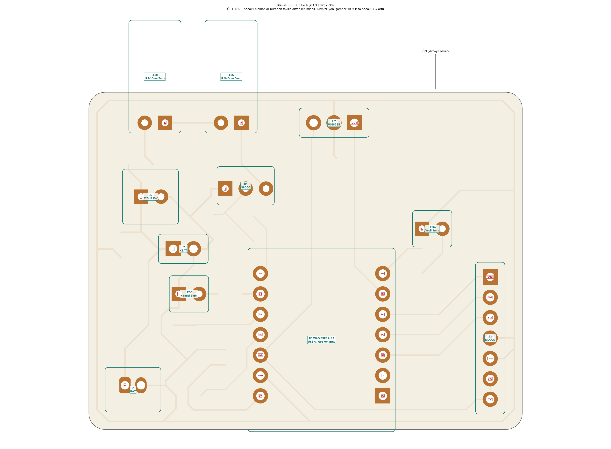
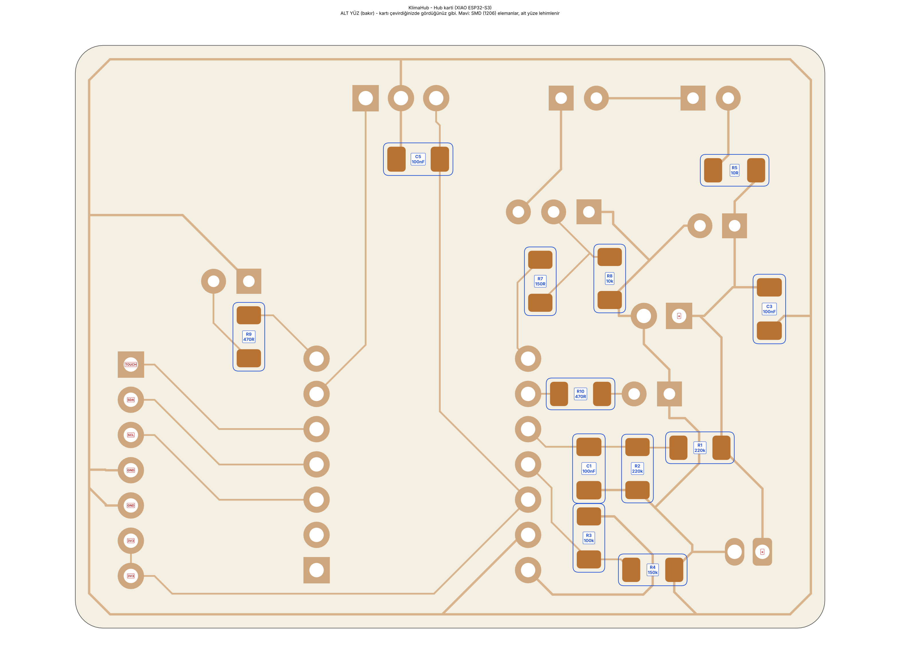
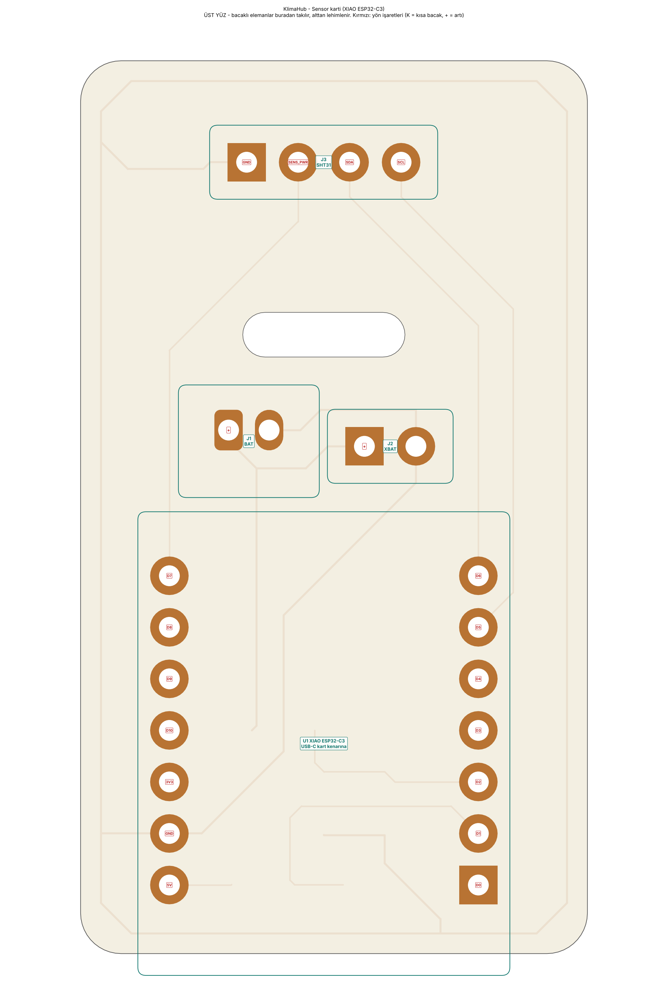
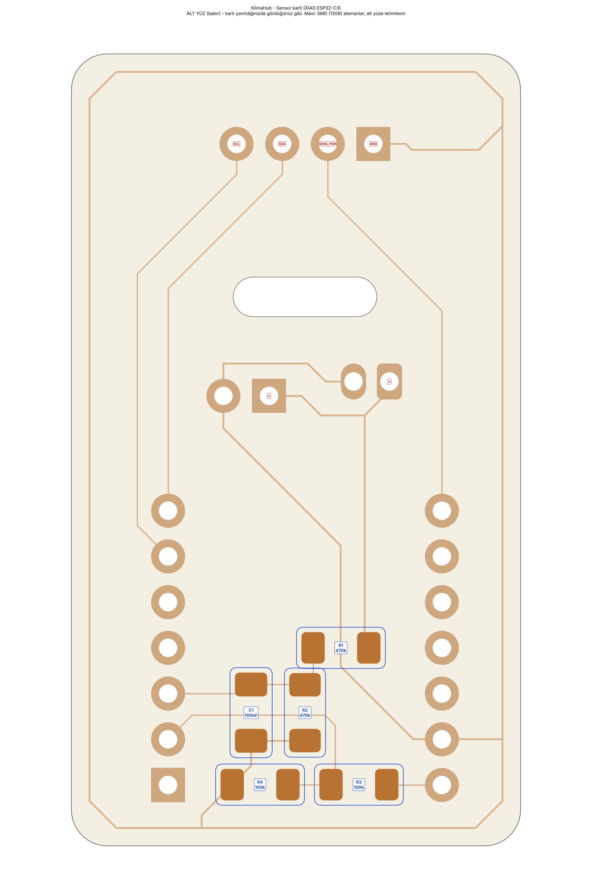
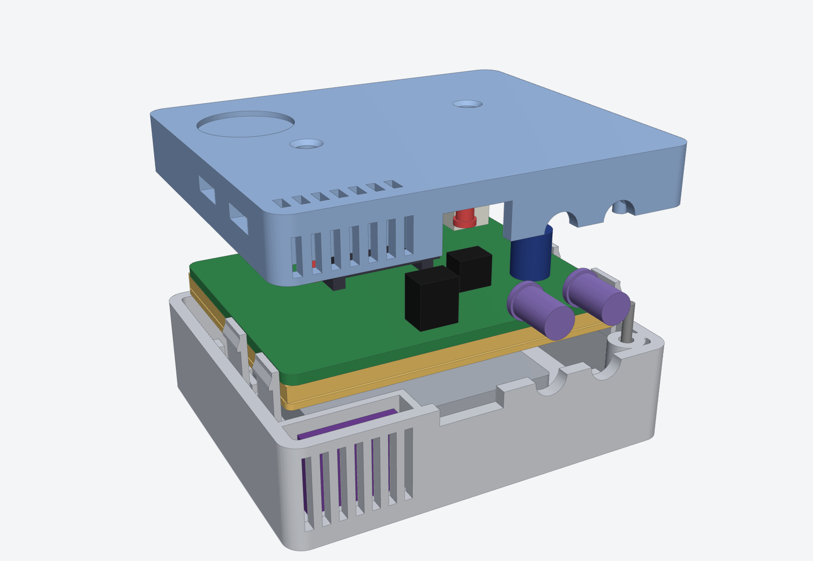
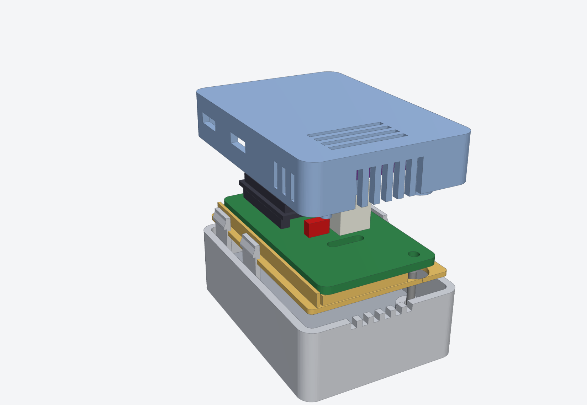

# Montaj

Bu belge kartların lehimlenmesini ve kutulara yerleştirilmesini adım adım anlatır.
Kartı CNC'de üretmek için önce [CNC.md](CNC.md), malzemeler için
[MALZEME_LISTESI.md](MALZEME_LISTESI.md).

> **En önemli iki kural**
> 1. Pil fişinin kutuplarını takmadan önce **multimetreyle ölçün** (malzeme listesindeki uyarı).
> 2. Pili en son takın. Lehim yaparken pil takılı olmasın.

## 0. Genel bilgiler

> **Fabrikada ürettirilen kart** ([pcb/fab/README.md](../pcb/fab/README.md)) kullanıyorsanız
> adımlar aynıdır. Farklar: delikler metal kaplı olduğu için lehim deliğe kendiliğinden
> ilerler; kartın üstünde eleman adları, `+` işaretleri ve pin adları yazılıdır.
> 1206 elemanlar yine **alt yüze** lehimlenir.

- Kartlar **tek yüzlüdür**: bakır alt yüzdedir. Bacaklı elemanlar **üstten** takılır,
  **alttan** lehimlenir. Küçük SMD dirençler ve kondansatörler (1206) doğrudan **alt yüze**
  lehimlenir.
- Her kart için iki montaj haritası vardır:
  - `pcb/cnc/<kart>/montaj_ust.png`: üst yüz. Bacaklı elemanlar ve **yön işaretleri**.
  - `pcb/cnc/<kart>/montaj_alt.png`: alt yüz (kartı çevirdiğinizde gördüğünüz gibi, aynalı).
    SMD elemanlar ve değerleri.
- Haritadaki kırmızı işaretler:
  - **K**: LED'in katodu, yani kısa bacağı (gövdedeki düz kenar tarafı).
  - **+**: elektrolitik kondansatörün uzun bacağı, pilin artı ucu.
  - **E**: transistörün emiteri.
  - **OUT**: IR alıcının çıkış bacağı.
  - Pin adları (D0…D10, 3V3, GND, 5V, TOUCH, SDA…).
- Kartta 1 numaralı ped köşelidir (kare). Yön işaretleri hep bu pede denk gelir.
- **Sıra:** önce alçak elemanlar (SMD), sonra yüksekler. Her elemanı lehimledikten sonra alttan
  çıkan bacakları **1.5 mm'den kısa** kesin. Kutunun ara plakası alttan 2.4 mm boşluk bırakır.

### SMD (1206) nasıl lehimlenir

1. Pedlerden birine biraz lehim eritin.
2. Elemanı cımbızla tutup o lehimi tekrar eritin, eleman pede otursun.
3. Diğer ucu lehimleyin, sonra ilk ucu bir kez daha ısıtıp düzeltin.

Flux kullanmak işi çok kolaylaştırır. Direnç ve kondansatörlerin yönü yoktur.

## 1. Hub kartı

### 1.1 SMD elemanlar (alt yüz)

| Ref | Değer | | Ref | Değer |
|---|---|---|---|---|
| R1, R2 | 220k | | R8 | 10k |
| R3 | 100k | | R9, R10 | 470 Ω |
| R4 | 150k | | C1, C3, C5 | 100 nF |
| R5 | 10 Ω | | | |
| R7 | 150 Ω | | | |

### 1.2 XIAO ESP32-S3

1. **Önce pil kablolarını XIAO'ya lehimleyin** (karta takınca erişilemez). XIAO'nun alt
   yüzünde **BAT+** ve **BAT-** yazan iki küçük ped vardır. Pedleri önceden kalaylayın.
   Kırmızı kabloyu BAT+'ya, siyahı BAT-'ye lehimleyin (≈4 cm, 26–28 AWG).
2. 7'lik iki erkek pin header'ı XIAO'ya takın: **kısa uçlar XIAO'ya**, plastik ayırıcı arada.
   XIAO'yu header'larıyla birlikte karta yerleştirin. **USB-C kartın arka kenarına** (IR LED'lerin
   karşısındaki uzun kenar) bakmalı ve kart kenarıyla aynı hizada olmalı. Haritadaki pin adları
   XIAO'nun üstündeki yazılarla eşleşmeli.
3. Kartı ters çevirip 14 pini alttan lehimleyin, sonra header'ın XIAO tarafını lehimleyin.
4. XIAO'dan gelen pil kablolarını **J2 (XBAT)** deliklerine lehimleyin: kırmızı **+** (kare ped),
   siyah diğerine.

### 1.3 IR LED'ler (LED1, LED2), ön kenar

Bu LED'ler yatay durur ve gövdeleri kartın ön kenarından dışarı taşar; kutunun ön duvarındaki
deliklerden çıkarlar.

1. LED'in bacaklarını **gövdenin flanşından (alt kenar halkası) ≈1 mm uzakta 90° aşağı** bükün.
   Kısa bacak (K) kare pede gelecek.
2. LED'i takın: flanş kart kenarına yaklaşık dayanmalı, LED'in ekseni karttan **≈3 mm**
   yukarıda olmalı.
3. Lehimlemeden önce **kutunun alt gövdesinde prova edin**: kartı yerine koyunca LED'ler ön
   duvardaki yarım deliklere tam oturmalı. Gerekirse bükümü düzeltin, sonra lehimleyin.
4. İki LED de düz bakabilir. Klima sizden yukarıdaysa birini hafifçe (≈10–15°) yukarı
   bükebilirsiniz.

### 1.4 Diğer bacaklı elemanlar

| Ref | Eleman | Yön | Not |
|---|---|---|---|
| U2 | VS1838B IR alıcı | **Kubbe öne** (kartın ön kenarına) bakar | Dik takın. Bacakları 2–3 mm bırakın. Kubbe öne bakınca bacaklar kendiliğinden doğru deliklere gelir (OUT kare pedde) |
| Q1 | S8050 | **Düz yüzü arkaya** (XIAO'ya) bakar | E kare pedde |
| C2 | 220 µF | Uzun bacak (+) kare pede | En fazla 7 mm yükseklik, dik |
| LED3 | Kırmızı 3 mm | Kısa bacak (K) kare pede | **Uzun bacaklı bırakın:** LED gövdesinin altı karttan ≈6.5 mm yukarıda olsun. Kolay yol: LED'in altına 6–7 mm'lik bir karton şerit koyup öyle lehimleyin. LED'in tepesi kapaktaki delikten görünecek |
| LED4 | Yeşil 3 mm | Kısa bacak (K) kare pede | LED3 ile aynı yükseklik |
| J1 | JST-PH soket | Pil fişi **üstten** takılır | Pil kablosu sol kenardan aşağı iner |

### 1.5 Modül kabloları (J3)

J3'e header takılmaz, kablolar doğrudan deliklere lehimlenir. Pin sırası (kare ped 1 numara,
kartın ön kenarına en yakın olan):

| J3 pin | Sinyal | Bağlanan |
|---|---|---|
| 1 | TOUCH | TTP223 **I/O** (veya OUT/SIG) |
| 2 | SDA | SHT31 **SDA** |
| 3 | SCL | SHT31 **SCL** |
| 4 | GND | TTP223 **GND** |
| 5 | GND | SHT31 **GND** |
| 6 | 3V3 | TTP223 **VCC** |
| 7 | 3V3 | SHT31 **VIN** (veya VCC) |

- **TTP223** kapağın altına, J3'ün hemen üstüne gelir: ≈5 cm kablo yeterli.
- **SHT31** kutunun sağ önündeki havalandırmalı odacığa gider: ≈8 cm kablo bırakın.
- SHT31 modülünde ADR pini varsa boş bırakın. Yazılım 0x44 ve 0x45 adreslerini dener.

### 1.6 Kontroller (pil takmadan)

1. Multimetreyi süreklilik (bip) konumuna alın:
   - J1'in iki pini arasında **kısa devre olmamalı** (C2 şarj olurken kısa bir bip normal).
   - XIAO'nun 3V3 ile GND pinleri arasında kısa devre olmamalı.
2. Hub'ı **yalnız USB ile** bilgisayara bağlayın. Yeşil LED birkaç kez titrer (normal), sonra
   yavaş yanıp söner (WiFi bekleniyor). Yazılım yükleme: [KURULUM.md](KURULUM.md).
3. Kutuplarını ölçtüğünüz pili J1'e takın.

> Hub'ın IR LED'leri **pilden** beslenir. Pil takılı değilse IR gönderilmez.

## 2. Sensör kartı (×2)

1. **SMD (alt yüz):** R1, R2 = 470k, R3 = 100k, R4 = 150k, C1 = 100 nF.
2. **XIAO ESP32-C3:** Hub'daki gibi. Önce BAT+/BAT- kablolarını XIAO'ya lehimleyin, sonra
   header'larla karta takın. **USB-C kartın alt kenarına** (yarığın uzağındaki kısa kenar)
   bakar. Kablolar **J2 (XBAT)**'ye gider, kırmızı **+** kare pede.
3. **J1** JST-PH soketi.
4. **SHT31 kabloları (J3):** kartın üst kenarındaki 4 delik, kare pedden başlayarak:

   | J3 pin | Sinyal | SHT31 pini |
   |---|---|---|
   | 1 | GND | GND |
   | 2 | SENS_PWR | **VIN** (veya VCC). Sensör yalnız ölçerken beslenir |
   | 3 | SDA | SDA |
   | 4 | SCL | SCL |

   Kablo boyu ≈3 cm. Modül ön kapağın iç yüzüne yerleşecek.
5. **Vida deliği:** kartın sol üst köşesindeki büyük delik (M2) boş kalır.

## 3. Hub kutusu

Parçalar: `enclosure/hub/hub_alt_govde.stl`, `hub_kapak.stl`, `hub_ara_plaka.stl`. Baskı
ayarları: [enclosure/README.md](../enclosure/README.md).

1. **Pil:** Alt gövdenin tabanındaki köşe kılavuzlarının arasına çift taraflı bantla yapıştırın.
   Kabloları sol arka köşeye doğru yönlendirin.
2. **Ara plaka:** Tabandaki 4 ayağın üstüne oturtun, raylı yüzü yukarıda. Pil kablosu ara plaka
   ile sol duvar arasındaki boşluktan yukarı çıkar.
3. **Kart:** Kartı ara plakanın raylarına yerleştirin. IR LED'ler ön duvardaki yarım deliklere,
   USB-C arka duvardaki açıklığa gelmeli.
4. Pil fişini J1'e takın (kutupları kontrol ettiniz, değil mi?).
5. **SHT31:** Sağ öndeki odacığa koyun. Sensör çipi ön ızgaraya baksın. Odacığın arka duvarına
   bir damla sıcak silikonla yapıştırın. Kablolar odacık duvarının üstünden geçer.
6. **TTP223:** Kapağın iç yüzündeki dikdörtgen çerçeveye, **dokunma yüzü kapağa bakacak**
   şekilde çift taraflı bantla yapıştırın. Küçük modüllerde dokunma pedi, elemanların olmadığı
   arka yüzdür.
7. **Anten:** Anteni kapağın iç yüzünün sol ön bölgesine (IR LED'lerin üstü) yapıştırın. U.FL
   ucunu XIAO'daki konnektöre "tık" sesi gelene kadar dik bastırın.
8. **Kapağı kapatın:** Durum LED'leri kapaktaki deliklere girmeli. 4 tırnak "tık" diye oturur.
   Tabandaki tek vida deliğinden (IR LED'lerin olduğu ön tarafta, köşede) **M2 × 10 vida**
   takın. PLA'ya yolunu açarken yavaş ve fazla sıkmadan çevirin.
9. İsterseniz tabana kauçuk ayak yapıştırın.

**Kapağı açmak:** Vidayı sökün. Yan duvarlardaki küçük pencerelerden tırnakları ince bir
tornavidayla içeri bastırıp kapağı kaldırın.

## 4. Sensör kutusu (×2)

1. **Pil:** Arka gövdenin tabanına bantla yapıştırın. Koruma devresi (pil kablosunun çıktığı uç)
   **üstte**, vida sütununun yanında olsun. Kabloları sol üst köşedeki boşluktan yukarı alın.
2. **Ara plaka:** Yan duvarlardaki raflara oturtun. Sol üstteki kesik pil kablosu içindir,
   yuvarlak delik vida sütununa geçer.
3. **Kart:** Vida deliği sütunun üstüne gelecek şekilde ara plakaya oturtun. USB-C alttaki
   açıklığa bakar.
4. Pil fişini J1'e takın.
5. **SHT31:** Ön kapağın iç yüzünde, üstteki iki rayın arasına yerleştirin. Sensör çipi kapağın
   ızgarasına baksın. Kenarından bir damla sıcak silikonla sabitleyin.
6. **Anten:** Ön kapağın iç yüzüne, XIAO'nun tam üstüne gelmeyecek şekilde (kapağın alt yarısı,
   yan tarafa doğru) yapıştırın, U.FL ucunu takın.
7. **Kapağı kapatın:** Kapaktaki perde, karttaki yarıktan geçerek odacığı ayırır. 4 tırnak oturur.
8. Arkadan **M2 × 10 vida**yı sütundaki delikten takın. Vida kartı ve kapağı birlikte sıkıştırır.
9. **Duvara montaj:** Arka yüze çift taraflı köpük bant yapıştırın (vida başı bandın altında
   kalır). **USB-C aşağı** bakacak şekilde, güneş ışığı ve ısı kaynaklarından uzak bir duvara
   yapıştırın. Şarj için kutuyu duvardan sökmeden alttan USB-C takabilirsiniz.

## 5. Sorun giderme

| Belirti | Olası neden |
|---|---|
| XIAO hiç açılmıyor | J1'de pil ters takılı (XIAO zarar görmüş olabilir), 3V3–GND kısa devre |
| Hub IR göndermiyor | Pil takılı değil veya boş. IR LED ters (kısa bacak kare pedde mi?). Q1 ters (düz yüz XIAO'ya bakmalı) |
| Kumanda öğrenilmiyor | VS1838B ters: kubbe öne bakmalı. 3V3 ve GND'yi ölçün |
| Sensör "SHT31 okunamadı" | J3 kablo sırası. SHT31 modülünün VIN'i J3-2'ye gitmeli |
| Hub sıcaklığı yüksek gösteriyor | Normal (XIAO ısınır). Uygulamada **Ayarlar → Hub sensörü → sıcaklık düzeltmesi** ile termometreye göre düzeltin |
| Pil yüzdesi yanlış | Uygulamada pil voltajını multimetreyle karşılaştırın. Sensörde `platformio.ini` içindeki `BATT_CAL` ile düzeltilir |
| Kapak zor kapanıyor | `enclosure/build_enclosures.py` içinde `FIT` değerini 0.2–0.25 yapıp kapağı yeniden basın |
