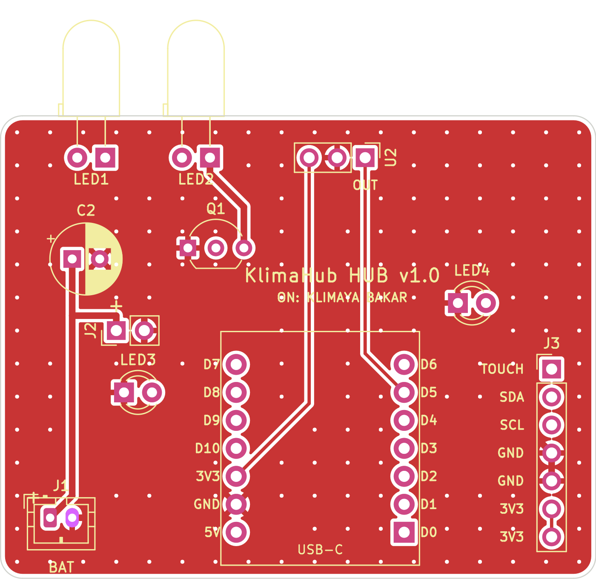
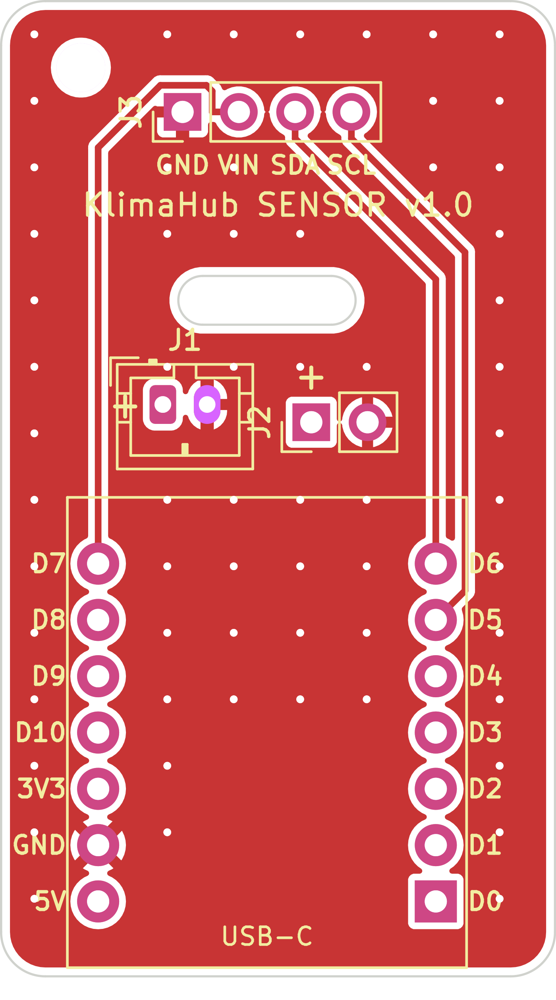

# Fabrika Kartları (PCB siparişi)

CNC'de kazımak yerine kartları bir PCB fabrikasına (JLCPCB, PCBWay vb.) ürettirmek için.
Kart ölçüleri, eleman yerleşimi ve pinler CNC sürümüyle **aynıdır**: kutular, yazılım ve montaj
haritaları (`pcb/cnc/<kart>/montaj_*.png`) değişmeden geçerlidir.

| Kart | Ölçü | Sipariş dosyası |
|---|---|---|
| Hub | 54 × 42 mm | `uretim/hub/klima-hub-gerber.zip` |
| Sensör | 25 × 44 mm (yarıklı, M2 delikli) | `uretim/sensor/klima-sensor-gerber.zip` |




## CNC sürümünden farkları

- **2 katman** (üst + alt bakır), delikler metal kaplı, iki yüzde GND dolgusu ve dikiş vialar.
- İzler 0.3 mm (güç hatları 0.6 mm), boşluk 0.2 mm. Fabrikaların standart kurallarının
  rahatça içinde (en küçük delik 0.35 mm via).
- Lehim maskesi ve **serigrafi**: eleman adları, pil ve XBAT için `+`, XIAO pin adları, J3
  pin adları, IR alıcının `OUT` bacağı.
- Elemanlar aynı yüzlerde: bacaklı elemanlar üstten takılır; 1206 direnç ve kondansatörler alt
  yüze lehimlenir (alt yüzde serigrafide adları yazar, değerleri `montaj_alt.png`'de).

## Sipariş (JLCPCB örneği)

1. https://jlcpcb.com → **Order now** → zip dosyasını yükleyin. Ölçü otomatik okunur.
2. Ayarlar (gerisi varsayılan kalabilir):

| Ayar | Değer |
|---|---|
| Base Material | FR-4 |
| Layers | **2** |
| PCB Qty | 5 (en az adet; hub için 1, sensör için 2 gerekir, kalanı yedek) |
| PCB Thickness | **1.6 mm** (kutular buna göre çizildi) |
| PCB Color | İstediğiniz (yeşil en ucuz ve en hızlı) |
| Surface Finish | HASL (lead-free önerilir) |
| Outer Copper Weight | 1 oz |
| Remove Order Number | Önemli değil. "No" seçerseniz fabrika kartın bir yerine küçük bir sipariş numarası basar; "Yes" bazen ücretlidir |

3. Hub ve sensör iki ayrı tasarım olduğu için iki ayrı sipariş kalemi olur.
4. **PCBA (dizgi) gerekmez:** elemanlar elle lehimlenecek büyüklükte seçildi.

Diğer fabrikalarda da aynı zip yüklenir. Dosyalar KiCad'in standart Gerber (Protel uzantılı)
ve Excellon biçimindedir. Sensördeki yarık ve dış hat `Edge_Cuts` katmanındadır, M2 delik
`NPTH.drl` dosyasındadır.

## Yeniden üretmek

```bash
python3 pcb/tools/build_fab.py all     # KiCad 7+, Java 21, Freerouting gerekir
```

KiCad dosyaları `pcb/fab/<kart>/` klasöründedir (DRC raporu dahil). Rapordaki serigrafi
uyarıları (taşan/çakışan yazı) üretimi engellemez: fabrika serigrafiyi pedlerden ve kenardan
kırpar. Bakır hatası ve bağlanmamış hat yoktur.
